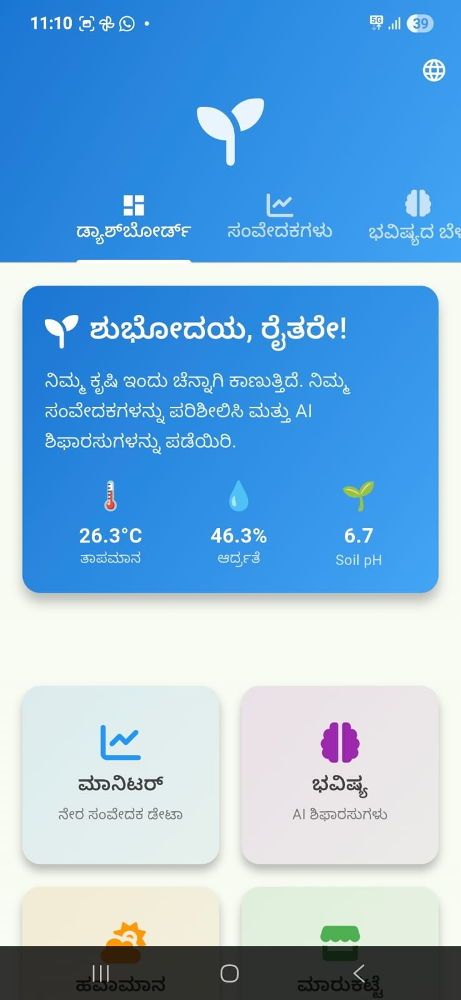
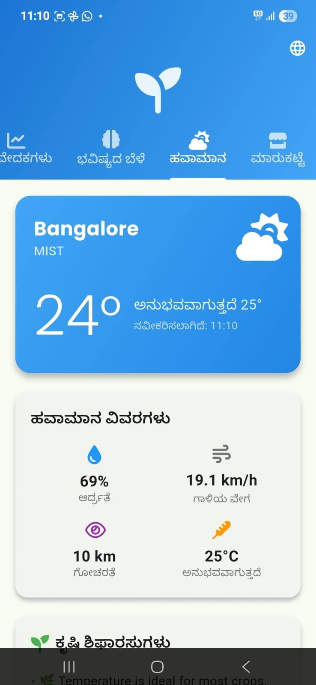
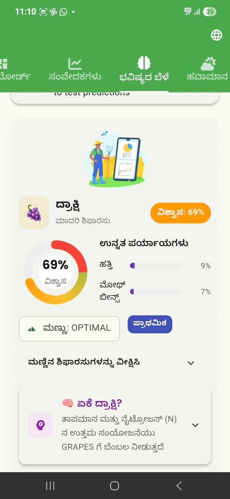
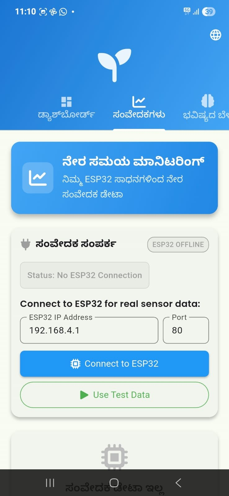
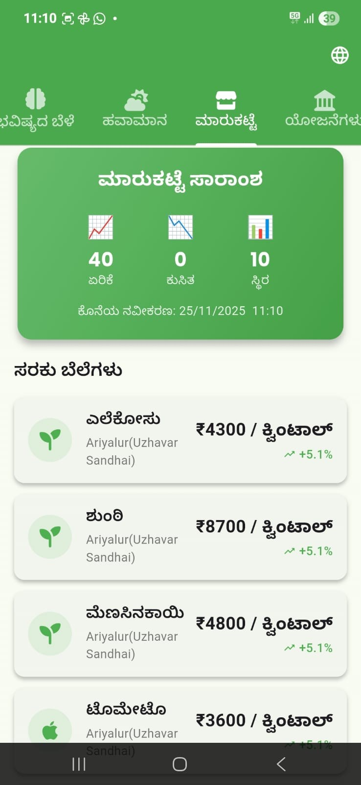
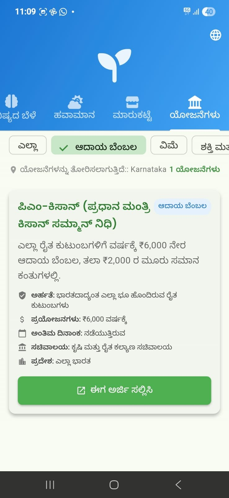

# Edge AI Crop Recommendation System — Edge-Powered Explainable AI Crop Recommendation System


## Overview

Edge AI Crop Recommendation System is a Flutter-based smart agriculture application designed to bring soil and environmental information, machine-learning-based crop recommendations, and agricultural resources into one mobile interface.

The supplied project includes an ONNX-based crop prediction service, an explainability layer that describes factors influencing a recommendation, ESP32 sensor connectivity, local prediction history, weather information, agricultural market prices, and government-scheme information. The interface supports English and Kannada.


## Key Features

### 1. Crop recommendation
- Uses seven input features: Nitrogen (N), Phosphorus (P), Potassium (K), temperature, humidity, soil pH, and rainfall.
- Integrates an ONNX model for crop prediction.
- Displays a recommended crop and prediction confidence as implemented by the application.

### 2. Explainable crop insights
- Presents feature-level explanations for a crop recommendation.
- Shows favorable conditions and limiting factors.
- Provides a human-readable explanation of why a crop may be suitable.

**Implementation note:** The current `XAIExplanationService` uses crop-specific ranges, configured feature-importance weights, and rule-based impact labels. It is not a SHAP or LIME attribution implementation. The displayed weights should not be interpreted as model-derived SHAP/LIME values.

### 3. IoT sensor monitoring
- Includes an ESP32 connection interface for retrieving sensor readings.
- Provides fields for the ESP32 IP address and port.
- Includes a test-data option in the monitoring interface.
- Supports soil and environmental data display.

The app's sensor interface is present in the source. Actual live readings require the ESP32 firmware, compatible sensors, network connectivity, and matching API endpoints to be configured and tested.

### 4. Weather dashboard
- Displays weather information and related environmental indicators.
- Includes location-related functionality.
- Uses an optional weather API integration.

### 5. Agricultural market information
- Provides a market section for displaying crop/commodity prices.
- Uses the market service included in the application.

### 6. Government agricultural schemes
- Includes national and state-level scheme information.
- Supports location-aware scheme presentation and category filtering as documented in `GOVT_SCHEMES_GUIDE.md`.
- Provides links to scheme application portals.

Scheme details and deadlines can change. Verify eligibility, benefit amounts, and application dates on the relevant official government portal before acting on the information.

### 7. Local prediction history
- Saves and displays previous crop predictions.
- Includes prediction-history statistics and management actions.
- Uses local app storage; this is not a cloud-synchronised database.

### 8. English and Kannada interface
- Includes English and Kannada localization resources.
- Provides a language selector in the application.
- Includes localized labels and XAI/history interface text.

## Application Screenshots

The following screenshots are from the supplied Android application build and show the Kannada interface.

| Dashboard | Weather |
|---|---|
|  |  |

| Crop explanation | ESP32 sensor monitoring |
|---|---|
|  |  |

| Market prices | Government schemes |
|---|---|
|  |  |

## Technology Stack

| Area | Technologies / components |
|---|---|
| Mobile application | Flutter, Dart |
| State management | Provider |
| Machine-learning inference | ONNX model, ONNX Runtime integration |
| Explainability | Crop-range analysis and rule-based explanations |
| IoT connectivity | ESP32, HTTP/WebSocket-related Flutter packages |
| Local storage | JSON/file-based prediction history, shared preferences |
| Networking | HTTP |
| Location | Geolocator, Geocoding |
| Charts and UI | fl_chart, Google Fonts, Lottie |
| Localization | Flutter localization, English and Kannada ARB resources |

## System Flow

```text
Soil / environmental sensors
            |
            v
          ESP32
            |
            v
   Sensor data connection
            |
            v
       Flutter app
            |
            v
   Input validation / mapping
            |
            v
       ONNX model
            |
            v
     Crop prediction
            |
            v
   Explainability service
            |
            v
 Recommendation + explanation
            |
            v
       Local history
```

The diagram describes the intended application flow represented by the supplied source. The live hardware path depends on the separately configured ESP32 firmware and compatible sensor endpoints.

## Model Input

The current ML service constructs the model input using the following feature order:

| Position | Feature |
|---:|---|
| 1 | Nitrogen |
| 2 | Phosphorus |
| 3 | Potassium |
| 4 | Temperature |
| 5 | Humidity |
| 6 | pH |
| 7 | Rainfall |

The model asset included in the supplied project is:

```text
assets/models/crop_prediction_model_ir9.onnx
```

Before using the model for real-world recommendations, verify that its training-time feature order, preprocessing/scaling, expected tensor shape, output mapping, and crop-label order match the application code.

## Project Structure

```text
.
├── android/                   # Android platform project
├── ios/                       # iOS platform project
├── web/                       # Flutter web platform files
├── assets/
│   ├── animations/            # Lottie animations
│   └── models/                # ONNX crop prediction model
├── lib/
│   ├── l10n/                  # English and Kannada localization
│   ├── models/                # Application data models
│   ├── providers/             # Provider state management
│   ├── screens/               # Dashboard and feature screens
│   ├── services/              # ML, XAI, sensor, weather, market services
│   ├── theme/                 # Theme configuration
│   └── widgets/               # Reusable UI components
├── screenshots/               # Application screenshots
├── test/                      # Flutter tests
├── CONTRIBUTIONS.md           # Project provenance and contribution notes
├── API_CONFIGURATION.md       # Optional API key configuration
├── GOVT_SCHEMES_GUIDE.md      # Government schemes feature notes
├── LOCALIZATION_GUIDE.md      # Localization notes
├── pubspec.yaml               # Flutter dependencies and assets
└── README.md
```

## Getting Started

### Prerequisites
- Flutter SDK compatible with the version constraints in `pubspec.yaml`
- Dart SDK (`>=3.0.0 <4.0.0`)
- Android Studio or VS Code with Flutter tooling
- Android emulator or physical Android device

### Install dependencies

```bash
flutter pub get
```

### Generate localization files

If generated localization files are not present or ARB resources have changed:

```bash
flutter gen-l10n
```

### Run the application

```bash
flutter run
```

To build an Android APK:

```bash
flutter build apk
```

## Optional API Configuration

The weather and news services use compile-time Dart environment values. Supply keys at run time/build time rather than committing them to source control.

```bash
flutter run \
  --dart-define=OPENWEATHER_API_KEY=your_openweather_key \
  --dart-define=NEWS_API_KEY=your_news_api_key
```

See [API_CONFIGURATION.md](API_CONFIGURATION.md).

> **Security note:** Compile-time values embedded in a client application can be extracted from the built app. Use appropriately restricted keys or a backend proxy for production. Rotate any credentials that may have been committed in an earlier version of the project.

## Hardware Integration

The mobile application includes an ESP32 monitoring interface. To use live sensor data:

1. Prepare and flash compatible ESP32 firmware.
2. Connect the ESP32 and mobile device to the required network.
3. Confirm the ESP32 address, port, endpoint paths, and response format match the Flutter sensor service.
4. Connect and calibrate the required sensors.
5. Test readings independently before using them as inputs to crop prediction.

The repository snapshot does not by itself establish that every hardware configuration is connected or currently operational. Refer to the firmware and hardware documentation available in your own project materials.

## Documentation

Additional project notes included in this repository:

- [Government Schemes Guide](GOVT_SCHEMES_GUIDE.md)
- [Localization Guide](LOCALIZATION_GUIDE.md)
- [XAI Localization Reference](XAI_LOCALIZATION_REFERENCE.md)
- [API Configuration](API_CONFIGURATION.md)
- [Contributions and Project Provenance](CONTRIBUTIONS.md)

Some supporting notes may describe the state of the project when they were written. Check the current source code and official external portals before relying on time-sensitive details.

## Testing and Validation

Before presenting this as a production-ready agricultural decision-support system, validate:

- ONNX model input order, preprocessing, output dimensions, and crop-label mapping.
- Prediction behavior using representative and out-of-range soil/environmental inputs.
- XAI explanation logic against the actual model behavior.
- Sensor calibration, communication failures, missing readings, and invalid values.
- English and Kannada text across all screens.
- Weather, market, and government-scheme data freshness and API failure handling.
- Application behavior on a physical Android device.


